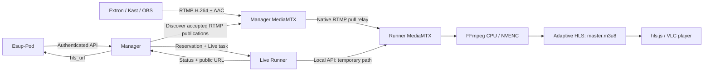

# Live: Manager, API contract and Pod integration

> **Starting a new deployment?** Follow the [short installation path](LIVE_INSTALLATION.md).
> **Operating an installed deployment?** Use the [Live operations runbook](LIVE_OPERATIONS.md).
> This page is the detailed API, configuration and architecture reference.

## Contents

- [Architecture and design choices](#architecture-and-design-choices)
- [Manager configuration](#manager-configuration)
- [Automatic RTMP-to-HLS operation](#automatic-rtmp-to-hls-operation)
- [Integration with Esup-Pod](#integration-with-esup-pod)
- [States, persistence and failures](#states-persistence-and-failures)
- [Installation and security](#installation-and-security)
- [Monitoring and troubleshooting](#monitoring-and-troubleshooting)
- [Reproducible test without streaming hardware](#reproducible-test-without-streaming-hardware)
- [Administration and statistics](#administration-and-statistics)

## Architecture and design choices

A Live session is an Esup-Runner `live` task. Its `live_id` is its `task_id`.
It reserves an entire Runner instance until cleanup is complete.
Four simultaneous streams require four Runner instances; they can be launched
from one `RUNNER_TASK_TYPES=[4x(live)]` declaration. No global limit is imposed.



The encoder publishes to the Manager's MediaMTX (normally RTMP port `1935`).
With `LIVE_ENABLED=true` and `LIVE_AUTO_START=true`, the Manager queries its
private Control API (`GET /v3/paths/list` and `/v3/paths/get/{path}`), identifies
each RTMP publication by connection UUID, and dispatches a session to an
available Live Runner. If capacity is exhausted, it retries on subsequent scans.

Discovery waits **five seconds between passes**; API latency and Runner
availability can extend startup. The interval is an internal default.
Control authentication and ports are documented under [configuration](#manager-configuration).

The broadcaster name is the source identifier: `live/amphi-a` becomes
`source_id=amphi-a`. It is the final RTMP path component and, when Pod integration
is enabled, must match the Pod broadcaster's `source_id` ("Live source identifier",
introduced in Pod 4.5.0). The Pod slug can be different. Broadcaster names are
public; full RTMP paths and authentication credentials are not exposed. Use publisher
credentials for authentication rather than treating the name as a secret.
`LIVE_SOURCES` optionally declares broadcaster/path bindings before publication.
It is not an allowlist: other accepted publications are discovered too.
With automatic startup,
each new publication starts a session when capacity is available. The optional
API mode can reserve a session before the source appears.

The Manager selects an available Runner whose `task_types` includes `"live"` and persists the task
before reserving it. The atomic reservation in the existing registry records the
`live_id`. Heartbeats and re-registration cannot clear it. A stale callback cannot
release a newer session. Workers of the same Manager share the files and locks
in `MANAGER_DATA_DIR`; two independent Managers must use separate directories,
tokens, network identities and MediaMTX instances.

A Runner can advertise `encoding,studio,transcription,live` and execute one
task at a time. An active Live session occupies that whole instance, including
for VOD scheduling. The Runner can also launch a VOD group and a Live group
from one `RUNNER_TASK_TYPES=[1x(encoding,studio),2x(live)]` declaration; those are
three independent instances with different API ports. Both Live instances share
one Runner MediaMTX service, encoder settings and credentials. HLS URL and
directory templates distinguish the instances. See the
[Runner configuration](../../runner/docs/LIVE.md#instance-configuration).

The Manager requests the relay through its authenticated `/task/run` call. The
Runner uses `POST /v3/config/paths/add/{name}` to create a `live/<live_id>`
path whose source is the internal RTMP URL of the Manager's MediaMTX instance.
**Data flows from the Manager to the Runner; the Runner opens the connection.**
The Manager does not run FFmpeg and does not need direct access to the Runner's
MediaMTX API. Deleting the path stops this native relay.

MediaMTX 1.21.1 also supports native push forwarding. The pull relay avoids
modifying the shared input path, keeps the encoder source available after the
event, and assigns cleanup to the process that supervises FFmpeg. Neither
approach requires transcoding on the Manager.
See the [proxy](https://mediamtx.org/docs/features/proxy),
[forwarding](https://mediamtx.org/docs/features/forward) and
[API v1.21.1](https://github.com/bluenviron/mediamtx/blob/v1.21.1/api/openapi.yaml)
references.

FFmpeg generates the ABR playlist and its variants directly. This provides a
single standard master playlist with a stable address throughout the session,
without combining separate MediaMTX HLS outputs. There is no passthrough mode.
See the [Runner configuration](../../runner/docs/LIVE.md).

## Manager configuration

Keep the existing installation and authentication. After installing MediaMTX,
run the [connection helper](MEDIAMTX_SETUP.md#6-connect-the-applications-and-verify)
from the Manager directory:

```bash
cd /opt/esup-runner/manager
uv run scripts/configure_live.py
```

With the standard `manager` native installation, it prepares this minimal
Live block in the existing `manager/.env` (the actual password is copied privately):

```dotenv
LIVE_ENABLED=true
LIVE_MEDIAMTX_API_PASSWORD=installation-specific-control-secret
LIVE_MEDIAMTX_LOG_UNIT=esup-runner-mediamtx@manager.service
```

Automatic publication discovery, the `control` account, local API port `9997`
and fallback establishment `unknown` already have defaults. Only change the optional
[operator parameters](PARAMETERS.md#live-parameters) for your deployment.
Polling and control timeouts are internal constants, not `.env` settings.

`MANAGER_DATA_DIR` contains tasks, the Runner registry, Live locks, publication
checkpoints, the private `.live-sources.json` source registry and CSV
statistics. It defaults to `data`, relative to the working directory. Use a
separate absolute path for each Manager. Workers of the same instance share this
directory with `ENVIRONMENT=production`. Changing the directory, address or
credentials requires a coordinated restart. Also configure a separate
`CONFIG_ENV_PATH`, `LOG_DIR`, `MANAGER_PORT` and `MANAGER_PUBLIC_URL` for each
instance.

Control URLs are complete URLs: their ports are not derived from another address.
The public RTMP URL is configured on the encoder and proxy; Pod never reconstructs
it. The Runner separately configures the internal RTMP URL it uses to read from
this Manager.

`LIVE_SOURCES` can be omitted. To declare sources before publication, optionally add:

```dotenv
LIVE_SOURCES={"amphi-a":"live/amphi-a","amphi-b":"live/amphi-b"}
```

Each declaration key must match the broadcaster name at the end of its path.
Once discovered, the binding persists even if this setting is removed.
Assigning its broadcaster identifier to another full path is rejected.
The registry is atomically written with owner-only permissions and is shared by
Manager workers. Back it up with publication checkpoints; do not delete it to
rename a running source. It contains private RTMP paths.

MediaMTX owns publish authentication and path/IP permissions. Any accepted RTMP
publisher can now consume available Live capacity; restrict that access in
MediaMTX, not through `LIVE_SOURCES`. The Runner's `relay` account must have read
access to the corresponding paths. Supported paths contain letters, digits,
underscores and hyphens, optionally separated by `/`; paths containing URLs,
query strings or traversal components are rejected. Broadcaster names must start
with a letter or digit and contain at most 100 letters, digits, underscores or
hyphens. H.264/AAC remains required.

The Manager MediaMTX template sets `overridePublisher: true`: a new authenticated
publisher on the same RTMP path disconnects and replaces the current publisher.
The Manager notices the new connection ID, stops the previous automatic session,
waits for confirmed cleanup, then starts its replacement under the same
`source_id`. The source table shows one broadcaster row with the latest session's
metadata; both sessions remain in history. HLS can be temporarily unavailable
during cleanup and startup. Existing MediaMTX installations must apply this
setting to their publisher paths; changing the checkout template does not update
an installed configuration.

## Automatic RTMP-to-HLS operation

**Publishing RTMP is sufficient to start HLS.** With `LIVE_ENABLED=true`, the
Manager automatically discovers RTMP publications accepted by its MediaMTX, reserves
an available Live Runner and starts transcoding. Extron SMP 351, OBS and other
encoders only need their usual RTMP publishing configuration; no start API call
or encoder-side script is required. The Manager, Runner and MediaMTX services
must already be running: publishing starts a Live task and FFmpeg, not an
otherwise stopped systemd service.

1. Enable Live and configure MediaMTX Control API access as above. Keep
   `LIVE_AUTO_START=true`; no `LIVE_SOURCES` declaration is needed. Restart the
   Manager after changing its settings. New publications need no further edits.
2. Configure the encoder with the Manager MediaMTX address and RTMP port, that
   a path allowed by MediaMTX and its `publisher` credentials. Use H.264 video and AAC audio.
   The encoder does not need an Esup-Runner API token. For FFmpeg, a typical URL
   is `rtmp://manager.example.org:1935/live/<broadcaster>?user=publisher&pass=<password>`.
  To populate the Live **Establishment** and **Equipment** fields automatically,
  add the optional `etablishment` and `equipment` query parameters, for example:
  `rtmp://manager.example.org:1935/live/lecture-hall-a?user=publisher&pass=<password>&etablishment=Universit%C3%A9%20de%20Montpellier&equipment=SMP351`.
  The URL-decoded `etablishment` value becomes the task requester and therefore
  the establishment in `task_stats.csv`; when it is absent or invalid, the
  configured `LIVE_AUTO_ETAB_NAME` fallback is used (`unknown` by default).
  The Manager URL-decodes and accepts one identifier of 1 to 200 characters:
  the first character must be alphanumeric, and the remaining characters may
  be alphanumeric, `.`, `_` or `-`. Missing, duplicated or invalid values are
  ignored. The `user` and `pass` parameters are never stored or returned. The
  final RTMP path component (`lecture-hall-a` in this example) is used as the Live
  source identifier; it must exactly match the broadcaster's `source_id` in Pod.
  The Runner uses `GET /rest/broadcasters/?source_id=<identifier>` and updates
  only a unique exact match, using its resolved slug for the REST PATCH. The
  equipment value is independent metadata and is not used as the Pod source
  identifier.
  The Manager does not expose the private RTMP path or store the Pod URL and
  credentials.

The Manager forwards the decoded establishment as the task `etab_name`. The
Runner's optional `LIVE_POD_ESTABLISHMENT_NAME` filter must match this value
exactly before that Runner contacts its configured Pod. A centralized Runner
can therefore keep credentials for one establishment without sending requests
to that Pod for Live sessions belonging to another establishment.
3. Start publishing. The Manager detects the connection through MediaMTX's
   private Control API on its next scan (every 5 seconds),
   then dispatches a Live task. HLS becomes ready after FFmpeg has produced enough
   segments for every rendition. Control timeouts and busy Runners can extend
   this delay.
4. Open **Live** in the administration to find the session and playback link.
   An authenticated application can list known identifiers, then inspect one:

   ```bash
   curl -sS "$MANAGER_URL/live/sources" \
     -H "Authorization: Bearer $POD_TOKEN"
   SOURCE_ID=replace-with-an-identifier-from-the-list
   curl -sS "$MANAGER_URL/live/sources/$SOURCE_ID" \
     -H "Authorization: Bearer $POD_TOKEN"
   ```

   The response contains source measurements and a `live` object for the latest
   automatic session, or `null` if none has been allocated. Wait for
   `live.state=running`, `live.hls_ready=true` and use the exact `live.hls_url`.
   This is the last persisted session snapshot; `GET /live/{live_id}` refreshes
   it from the Runner. A previous completed session can remain visible while a
   new publication waits for capacity.
5. Stop publishing to end the automatic session. The Manager requests cleanup
   when it observes the disconnection, then releases the Runner. Republishing
   creates a new session with a new `live_id` and HLS URL, including when a quick
   disconnect/reconnect occurs between scans. The URL is stable within a session,
   not across separate broadcasts.

If no Live Runner is available, the Manager keeps watching and retries on later
scans. The encoder can remain connected; there is no need to republish just
because capacity was initially exhausted. Streams are not recorded or buffered
while waiting for a Runner. A publication shorter than a scan can be missed.

Automatic sessions are marked `automatic=true`, use the decoded RTMP
`etablishment` parameter or `LIVE_AUTO_ETAB_NAME` (default `unknown`) for
establishment statistics and `MediaMTX` as the application
name. Their event identifier is derived from the MediaMTX RTMP connection UUID.
Shared locks and persistent checkpoints prevent duplicate allocation across
Manager workers and restarts. A Manager restart also detects a source that
started publishing while it was offline. An unavailable MediaMTX API is treated
as an observation failure, not as proof that the publisher stopped.
Discovery reads the runtime path list in pages of 100, up to 100 pages per scan.
Only ready RTMP/RTMPS publisher connections are eligible; static pull sources and
other protocols are ignored. Malformed paths are reported without exposing keys.
Known active sessions are checked individually even when discovery is unavailable;
inactive historical sources are not polled indefinitely.

An explicit stop from the administration or API stays effective until the
encoder disconnects and republishes, or an operator uses **Restart session**.
When a Runner shutdown or forced restart recovery terminates an automatic
session with `Runner stopped` or `Runner restarted; session stopped safely`,
the Manager creates a replacement automatically after cleanup is confirmed
if the same RTMP connection is still publishing. The replacement has a new
`live_id` and HLS URL; update the player from the new status response. Other
terminal failures do not start an endless loop of new tasks for the same
connection: correct the cause and republish, or use **Restart session** without
disconnecting the encoder. The Runner still applies its bounded FFmpeg retries
before reporting failure. Checkpoints
in `MANAGER_DATA_DIR/.live-publication-<source_id>.json` survive task-history
retention; keep them with the Manager's persistent data.

Automatic sessions belong to the Manager and can be read or stopped by clients
with a valid existing API token, as well as by administrators. API-created
sessions keep their original client-token ownership. The watcher neither
replaces nor stops an active API-created session on the same source.

## Integration with Esup-Pod

The existing Pod implementation was reviewed on `main`, commit
`a3e68290ad6fb88f258175c706e403e6f7ebf966`:

- [`runner_manager.py`](https://github.com/EsupPortail/Esup-Pod/blob/a3e68290ad6fb88f258175c706e403e6f7ebf966/pod/video_encode_transcript/runner_manager.py)
  already submits tasks to `task/execute`, with a Bearer token and a
  `runner/notify_task_end/` callback. Manager selection already exists in Pod.
- [`live/models.py`](https://github.com/EsupPortail/Esup-Pod/blob/a3e68290ad6fb88f258175c706e403e6f7ebf966/pod/live/models.py)
  stores the playback URL in `Broadcaster.url`. This remains usable for
  conventional broadcasters.

The future dynamic mode must store the Manager and `source_id` on the broadcaster,
then the selected Manager and returned `live_id` on each event. The selected
Manager **must be the one receiving the RTMP source**: round-robin selection
between independent Managers is unsuitable for this call. Do not make the
broadcaster depend on the Runner's identity or address.

### Start a session

This call is **optional**. For RTMP-driven broadcasts, discover the automatic
session by source as described above. Set `LIVE_AUTO_START=false` when a client
should exclusively control allocation and the lifecycle; it can then reserve a
Runner before publication. An API start for a source already used by an automatic
session returns `409`.

All calls use the existing authentication, `Authorization: Bearer` or
`X-API-Token`. Use a Pod token separate from the Runner token.

```bash
curl -sS -X POST "$MANAGER_URL/live/start" \
  -H "Authorization: Bearer $POD_TOKEN" -H 'Content-Type: application/json' \
  -d '{"source_id":"amphi-a","event_id":"pod:event:42:session:1","equipment":"SMP351","etab_name":"University","app_name":"Esup-Pod"}'
```

`202` response (additional monitoring fields omitted here):

```json
{
  "live_id": "d6e7aa69-d1f8-46c4-b23e-4f0202e14cd2",
  "source_id": "amphi-a",
  "event_id": "pod:event:42:session:1",
  "equipment": "SMP351",
  "runner": "live-02_0",
  "state": "waiting_source",
  "hls_ready": false,
  "hls_url": null
}
```

`event_id` is a stable idempotency key for this Pod token. Repeating the same call
returns the same session, even after it has ended. To start a new session for the
same event, change its session suffix. Reusing the same event with a different
source returns `409`. A source already used by another active event also returns
`409`. If no Runner is available, the response is `503`: Pod can retry with the
same key, without a hidden queue or over-allocation. An unknown source
returns `404`.
For API-only mode, use an optional declaration to reserve a never-published source in
advance, or reuse an identifier already saved by automatic discovery.

### Retrieve the URL

```bash
curl -sS "$MANAGER_URL/live/$LIVE_ID" -H "Authorization: Bearer $POD_TOKEN"
```

```json
{
  "live_id": "d6e7aa69-d1f8-46c4-b23e-4f0202e14cd2",
  "source_id": "amphi-a",
  "event_id": "pod:event:42:session:1",
  "state": "running",
  "hls_ready": true,
  "hls_url": "https://live.univ.fr/runner-2/hls/d6e7aa69-d1f8-46c4-b23e-4f0202e14cd2/master.m3u8",
  "hls_sessions": 2
}
```

`hls_sessions` is an estimate of concurrent viewers based on recent HLS
requests. It can be `null` when the Runner has no supported observation.

| Default rendition | Video + audio bitrate | Bandwidth to allow per viewer (+20%, rounded) |
| --- | ---: | ---: |
| High (720p) | 1.228 Mbit/s | ~1.5 Mbit/s |
| Medium (406p) | 0.656 Mbit/s | ~0.8 Mbit/s |
| Low (270p) | 0.344 Mbit/s | ~0.42 Mbit/s |

Pod uses **the exact `hls_url` value**, without deriving it from `runner` (an
operational information field). The Runner builds this URL from its configured
public base URL; the Manager validates, persists and exposes it as the source of
truth. Each status query refreshes the state from the Runner. If the Runner is
unreachable, the API hides the URL and retains the reservation, with a diagnostic
message. An internal URL such as `http://runner-host:8084/hls/...` can therefore be
exposed through an entirely different HTTPS domain and prefix.
For multiple instances on one Runner host, configure the public base URL as
`https://live.univ.fr/runner-{instance_id}/hls` and use the single-rule HAProxy
example in the [Runner Live guide](../../runner/docs/LIVE.md#haproxy-with-one-rule-for-multiple-instances).

For API-created sessions, use the same Pod token to query and stop the session
(`403` otherwise). Automatic sessions are shared by authenticated API clients.
The Live contract uses status polling rather than Pod's VOD result callback.
The existing `/task/status/{task_id}` and `/task/details/...` endpoints still
expose the task and its metadata; `/task/result` does not provide a VOD result for
a Live session. Pod must not use its encoding manifest download flow for a Live
task.

### Stop a session

```bash
curl -sS -X POST "$MANAGER_URL/live/$LIVE_ID/stop" \
  -H "Authorization: Bearer $POD_TOKEN"
```

The `202` response exposes `stopping`, followed by `completed` when queried after
cleanup; `hls_url` becomes null as soon as a stop is requested. Repeating the stop
request is safe. Pod must wait for a terminal state before reporting that the
Runner has been released. Existing static URLs for other broadcasters remain
unchanged.

### Restart a stopped session without republishing

On `/admin/live`, wait until the previous session is `completed` or `failed`,
then use **Restart session** on the latest session for that source. The encoder
can keep publishing. The shared Bootstrap confirmation dialog describes the
action; cancelling it leaves the session unchanged and resumes page refresh.

Restart requires an active RTMP source and a free Live Runner. It creates a new
task, `live_id` and HLS URL, preserving the previous session in history. Automatic
replacements keep following the same publication and stop when it disconnects.
Update the player using the new session's `hls_url`; the old playlist is not revived.
The button is unavailable while any session for the source is active or cleaning up.

Authenticated API clients can perform the same operation:

```bash
curl -sS -X POST "$MANAGER_URL/live/$LIVE_ID/restart" \
  -H "Authorization: Bearer $POD_TOKEN"
```

The `202` response identifies the replacement. Repeating this request on the old
identifier returns the same replacement, even across Manager workers or restarts.
To restart again after that replacement ends, use its identifier. API-created
sessions retain their original token ownership; automatic sessions remain shared
by authenticated clients. `409` means cleanup is incomplete, the source is absent
or another session owns it; `503` means disabled Live, missing capacity or unavailable
media/storage control. Administration displays these failures without discarding history.

## States, persistence and failures

| Live state | Meaning |
| --- | --- |
| `pending` | Intent persisted; reservation in progress |
| `waiting_source` | Relay configured; waiting for an H.264/AAC source |
| `starting` | FFmpeg starting or recovering, or HLS temporarily unavailable |
| `running` | All HLS variants have readable, recent segments |
| `stopping` | Stop requested or cleanup incomplete; Runner remains busy |
| `completed` | Normal stop; relay and files removed |
| `failed` | Failure with cleanup complete; reason available |

The general `Task.status` remains `running` throughout all active states, then
becomes `completed` or `failed`. The 24-hour VOD timeout does not apply. A missing
source times out after 120 seconds on the Runner (a fixed internal default).
See the [Runner's internal Live defaults](../../runner/docs/PARAMETERS.md#internal-live-defaults).
Source loss, FFmpeg exits and stalled playlists trigger a limited number of
restart attempts. If MediaMTX is
unavailable during cleanup, the Runner remains busy.
For automatic sessions, a confirmed RTMP disconnection additionally triggers a
normal stop from the Manager; a new connection requires a new session.

After a restart, the Manager reloads reservations and tasks from disk. After a
Runner restart, it terminates surviving FFmpeg processes owned by the session,
removes the relay and files, and reports the recovered session as failed. If the
same publication is still active, no explicit stop was requested, and the failure
is `Runner stopped` or `Runner restarted; session stopped safely`, the Manager's
next source reconciliation creates the replacement described above. A
stop received before a delayed dispatch creates a persistent tombstone that
prevents a later start. Compact terminal Live states remain available after a
Runner restart so that a lost callback can be reconciled. Archive these files
only while the Runner is stopped and after sessions have been reconciled with the
Manager.

## Installation and security

Follow [Live installation](LIVE_INSTALLATION.md) for native startup or Compose,
and [MediaMTX setup](MEDIAMTX_SETUP.md) for custom paths and manual upgrades.
The installer generates separate private credentials for publisher, relay,
control and transcoder accounts; review YAML `ips` lists for authorized clients.

Expose the required RTMP input and HTTPS HLS frontend. Keep Control APIs,
metrics and Runner APIs private; use RTMPS or a private network for credentials.
Clients select source identifiers, not arbitrary URLs or FFmpeg options.
Responses omit RTMP keys and raw FFmpeg diagnostics.

Independent Managers require distinct environment/data/log files, tokens,
addresses and MediaMTX instances. Use absolute environment-file paths and
service-account-writable storage; workers of one Manager share its data directory.

### Docker Compose

For Docker prerequisites or a MediaMTX-only container alongside native
applications, see [MediaMTX with Docker](MEDIAMTX_SETUP.md#5-run-mediamtx-in-docker).
The complete stack below defaults both MediaMTX images to `bluenviron/mediamtx:1.21.1`.
You may choose another explicit stable tag >= 1.21.1. See
[manual upgrades](MEDIAMTX_SETUP.md#manual-upgrades) for the procedure and Live interruptions.

For the first deployment, follow the [Docker Compose shortcut](LIVE_INSTALLATION.md#docker-compose-shortcut).
It covers private configuration files, matching credentials, an administrator
password hash, browser-facing Manager/HLS URLs and startup validation. For an
existing deployment, retain and review the configured files instead of copying
over them. The details below cover networking, storage and additional workers.

The [Compose file](../../deploy/live/compose.yml) contains a Manager, its MediaMTX
instance, a Runner and its MediaMTX instance. Media APIs are not published. Host
ports are configured with `MANAGER_HTTP_PORT`, `MANAGER_RTMP_PORT` and
`RUNNER_HTTP_PORT`; bind addresses use `MANAGER_BIND_IP`, `RTMP_BIND_IP` and
`RUNNER_BIND_IP`. Internal MediaMTX addresses use `MTX_*ADDRESS` and the
corresponding complete URLs. The RTMP input binds to loopback by default;
explicitly select an interface address reachable by the encoders.
Set these Compose bind/port variables in the invoking shell or `deploy/live/.env`.
The service `env_file` entries (`manager.env` and `runner.env`) populate container
environments and do not control interpolation of host port mappings.

The Manager writes its application logs to the writable `manager-logs` volume
at `/var/log/esup-runner`. MediaMTX writes `mediamtx.log` to the separate
`manager-media-logs` volume. The Manager reads that volume at
`/var/log/mediamtx:ro`, with `LIVE_MEDIAMTX_LOG_FILE=/var/log/mediamtx/mediamtx.log`.
Do not mount it over the Manager's writable log directory. Task and Runner data
are persistent named volumes; HLS stays in the Runner container's `/dev/shm`.
The images initialize writable application data/log directories for their
service account. If reusing volumes from another UID/GID, correct ownership
before startup. Use the selected Compose project's actual volumes, rather than
the standalone container volume names from the component Docker guides:

```bash
docker compose -p live-a run --rm --no-deps --user 0 --entrypoint sh manager \
  -c 'chown -R "${SERVICE_USER}:${SERVICE_USER}" /app/data /var/log/esup-runner'
docker compose -p live-a run --rm --no-deps --user 0 --entrypoint sh runner \
  -c 'chown -R "${SERVICE_USER}:${SERVICE_USER}" /tmp/esup-runner /var/log/esup-runner'
```

These one-off containers change only their application data/log volumes; the
MediaMTX diagnostic mount stays read-only. Build the application images first
if this is a new checkout (`docker compose -p live-a build`).

`depends_on` starts dependencies in order but does not confirm application
readiness. Check `docker compose -p live-a ps`, logs and the first complete HLS
session after startup; temporary registration/media API errors should recover.
Manager and Runner containers have a 45-second stop grace period before Docker
forces termination, allowing normal media cleanup and durable recovery checkpoints.

The supplied Compose example fixes `RUNNER_TASK_TYPES=[1x(live)]`,
`RUNNER_INSTANCES=1` and publishes one Runner API port. To use grouped Live
workers in that container, update those Compose environment entries, also
publish/proxy each additional API port, and configure distinct public HLS URLs.
Native grouped deployment needs only one
Runner `.env` and one shared Runner MediaMTX service.

For independent Runner deployments attached to the same Manager, duplicate the
`runner`/`runner-media` pair with separate names, volumes, `RUNNER_BASE_NAME`,
`RUNNER_HOST`, published ports and public HLS base URLs. Do not use
`--scale runner`: this would share the Runner's identity and MediaMTX instance.
For multiple Managers, use independent Compose projects, ports and `.env` files.

## Monitoring and troubleshooting

- `GET /live/sources/amphi-a`: source presence, codecs, resolution, input and read
  counters from the Manager's MediaMTX instance, plus the latest automatic
  session in `live`, without exposing the secret path or API-owned session data.
- `GET /live/{live_id}`: state, Runner, timestamps, source, codecs, resolution,
  estimated input bitrate in bit/s, relay byte counters, estimated concurrent
  HLS viewers, transcoding errors and HLS status. Duration can be calculated
  from `created_at`.
- `GET /live/metrics`: Prometheus format; Esup-Runner authentication required.
  `live_sessions_total`, `live_sessions_running`, `live_runners_total`,
  `live_runners_busy`, `live_runners_available`, `live_input_bytes`,
  `live_forward_bytes` and `live_transcode_errors_total` are **gauges of the
  retained persisted state**, not monotonic counters. Their totals can decrease
  with retention. Media counters may reset after a reconnection.
- Native MediaMTX Prometheus servers provide additional information. Configure
  authentication and the collection network without exposing them publicly.

Transitions are logged with `live_id`, `stream_id` and `runner_id`. For a missing
source, first check `/live/sources/...`, the `publish` and `read` permissions,
then RTMP connectivity from the Runner to the Manager. For a persistent
`starting` state, check the H.264/AAC codecs and FFmpeg. For a persistent
`stopping` state, restore the MediaMTX API or HLS directory permissions; do not
manually mark the Runner as available while cleanup remains incomplete.
If a published source creates no task, check `LIVE_ENABLED`, `LIVE_AUTO_START`,
MediaMTX publish/read permissions, compatible paths, available Live capacity and the Manager Control
API credentials. If its latest automatic session was stopped or failed,
disconnect and republish after resolving the cause.

### Live diagnostics in the log viewer

Select **Live diagnostics** on the Live page or Logs page. It searches for
`[LIVE]`, and matching entries have a Live badge. Existing severity and text
filters still apply. Manager events identify allocation, state changes, stop,
restart, Runner-control failures and MediaMTX observation failures. Repeated
unchanged Runner failures do not produce a new transition entry each scan.

RTMP authentication happens inside MediaMTX, before the Manager sees a source.
MediaMTX 1.21.1 logs refused RTMP connections at **info**, so `logLevel: warn`
hides them. The supplied templates use `logLevel: info` and `logStructured: false`.
Choose one source for the Manager to read:

```dotenv
# Native deployment: Manager and MediaMTX use the same systemd user account.
LIVE_MEDIAMTX_LOG_UNIT=esup-runner-mediamtx@manager.service
# Alternative for Docker/remote log shipping: leave LOG_UNIT empty and mount a file.
# LIVE_MEDIAMTX_LOG_FILE=/var/log/esup-runner/mediamtx.log
```

The reader has no public input for command arguments or file paths. It reads at
most 2,000 recent journal lines with a three-second timeout, or the last MiB of a
regular file. Diagnostics therefore follow the source's retention and this recent
window, not the retention of task history. Journal access must work under the
Manager service account. File sources must be readable there; the supplied Compose
stack mounts the MediaMTX log directory read-only in the Manager. Manage raw-file
retention with your deployment's log rotation policy.

Only recognized events are shown; raw media lines, ingest paths, query strings,
usernames and passwords are excluded from the administration projection:

| Marker | Meaning |
| --- | --- |
| `RTMP_AUTH_FAILED` | Authentication refused: absent/incorrect credentials, or denied IP/path permissions. MediaMTX does not always distinguish them. |
| `MEDIA_AUTH_FAILED` | Authentication refused on another media control/protocol endpoint. |
| `SOURCE_PATH_REJECTED` | A published RTMP path is incompatible with the Runner path format. |
| `SOURCE_PUBLISHED` | Publication received for a known source identifier. |
| `SOURCE_DISCOVERY_FAILED` / `SOURCE_REGISTRY_UNAVAILABLE` | MediaMTX discovery or private source persistence is unavailable; check API access and storage. |
| `RTMP_CONNECTION_FAILED` / `PUBLISHER_CONFLICT` | Connection/protocol failure or competing publisher. |
| `MEDIA_LOG_UNAVAILABLE` | The configured journal/file cannot be read; other Manager logs remain available. |

These diagnostics supplement MediaMTX's own logs; they do not replace or weaken
its authentication. They cannot recover failures suppressed before `info` logging
was enabled. Changing MediaMTX's logging configuration reloads its listeners in
1.21.1 and interrupts existing connections: apply that change between broadcasts,
then reconnect the encoder. Restart the Manager after changing its `LIVE_*` settings.

## Reproducible test without streaming hardware

The optional test starts isolated local processes, two Manager workers and the
requested number of Runner/MediaMTX pairs, or one grouped Runner deployment
sharing a MediaMTX service with `--grouped`. It keeps data and logs under
`/tmp/live-smoke-*` and stops its processes when finished.

MediaMTX configuration files contain only SHA-256 verifiers of randomly generated
test passwords. In grouped mode, the shared `.env` contains only non-secret settings;
tokens and credential-bearing URLs are passed through the process environment.

```bash
cd runner
UV_CACHE_DIR=/tmp/esup-runner-uv-cache uv run --no-sync \
  python ../scripts/live_smoke.py --mediamtx "$HOME/.local/bin/mediamtx" --runners 4 --crash-recovery
```

To check the normal launcher with one `.env`, a VOD group and two concurrent
Live workers sharing MediaMTX, with RTMP-triggered allocation, use:

```bash
cd runner
UV_CACHE_DIR=/tmp/esup-runner-uv-cache uv run --no-sync \
  python ../scripts/live_smoke.py --mediamtx "$HOME/.local/bin/mediamtx" \
  --runners 2 --grouped --mixed --automatic --crash-recovery
```

`--automatic` verifies HLS without `POST /live/start`, encoder disconnection and
republication, explicit restart under the same publication, Manager restart without duplicate sessions, and an explicit stop
while the encoder remains connected. Without this option the test sets
`LIVE_AUTO_START=false` and exercises the optional API-driven workflow.
The additional `--crash-recovery` phase uses API-created sessions to check Runner
recovery independently of the RTMP trigger.

This also checks that stopping or crashing one Live does not remove a sibling's
relay or HLS output. The launcher restarts the crashed worker from its persistent
state. Omit `--mixed` to make the Live workers exclusively Live-capable.

Prerequisites: both component development environments installed, FFmpeg, ffprobe,
MediaMTX >= 1.21.1 and available loopback ports. The test publishes `testsrc2` + `sine`
and checks all three variants with `ffprobe`, distinct reservations, rejection of
an additional Live session, repeated stop requests and cleanup. It uses the
provided YAML examples with temporary secrets to verify RTMP and Control API
authentication. `--crash-recovery` also checks recovery after an abrupt Runner
termination and cleanup of its surviving FFmpeg process. Add `--mixed` to
advertise `encoding,studio,transcription,live` on each test Runner and exercise
Live allocation on mixed instances. No GPU is required.
The test also submits anonymous and wrong-password RTMP publications and checks
that MediaMTX rejects and logs them.
For browser/VLC playback and source loss tests, follow the
[Runner procedure](../../runner/docs/LIVE.md).

## Administration and statistics

Open **Live** from the Manager dashboard (`/admin/live`). It uses the same
administrator authentication and CSRF protection as the existing administration.
The page refreshes every 15 seconds; pause it for inspection. It also holds
refresh while a filter has focus or session details are expanded.

The overview shows active sessions, confirmed HLS playback, available Live
workers (including mixed workers) and active sessions needing attention.
Search by broadcaster, source, event, session, runner or establishment, filter
by lifecycle state, and browse retained history in pages of 50 sessions. Search
matches partial names without case sensitivity (for example `AGROECO` matches
`agroecologie`); sessions without a known broadcaster still support the other
search fields. Expand a session
for timestamps, elapsed time including waiting/cleanup, source and byte
counters. The first session column shows the Broadcaster instead of source/event
identifiers; those identifiers remain available in **Session details**, without
repeating the Broadcaster field. Codecs
and resolutions share one line to keep session rows compact.
The **Start / end** column after **Runner** uses the administration's
`YYYY-MM-DD HH:MM:SS` display format without fractions of a second. Start is
the session creation time, including waiting for the source; end is the last
persisted update after the Manager confirms completion or failure, including
cleanup. It is not the precise timestamp at which the encoder stopped.
Non-terminal sessions show **Ongoing** instead of an end time; missing timestamps
show **Unknown**. The original stored timestamps remain unchanged.
Input bitrate, source readiness, counters and transcoder errors come from the
last Runner report. Codecs and resolutions retain the last non-empty lists
observed for that session, including after source loss or terminal cleanup.
New non-empty lists replace the previous values; empty reports never imply an
active signal and do not copy metadata between sessions. If a session never
reported track information, the page shows **Codecs unknown** and
**Resolution unknown**. Previously lost metadata cannot be reconstructed without
a new observation. These measurements are not an end-to-end player
probe or viewer counts. A known source without a session has no Runner
measurements on this page.

**Active and recent sources** lists current known RTMP publishers (including
those waiting for Runner capacity), sources referenced by retained sessions and
explicitly declared `LIVE_SOURCES` broadcasters. Historical discovered sources
disappear from this list when their last session is removed by
`CLEANUP_TASK_FILES_DAYS` retention or an administrator. Active Live sessions
remain protected from age-based cleanup; setting retention to `0` keeps session
history indefinitely. Declared broadcasters remain visible under their source
identifiers.
If the MediaMTX observation fails, the page temporarily shows all known sources
with an unconfirmed-publications notice. Monitoring never deletes or updates
the private source registry or publication checkpoints; authenticated source
discovery continues to return all known identifiers.

The source table starts with the full Broadcaster name, which is also the source
ID, with a copy button. The name is displayed directly, without a separate full
source ID panel. It shows establishment/equipment metadata, current RTMP signal,
latest retained session state and creation date, and a **View sessions** link
that resets filters to all sessions for that source. Publication presence is
independent of HLS session state: an encoder can still publish after its session
has stopped or failed. RTMP signal is **Not verified** when the observation is
unavailable or Live is disabled. Origin metadata comes from the latest retained
session and is marked **Historical** after termination; missing values are
shown as **Not provided**. Stale active Runner reports are identified separately.
No extra per-source media request is made. Clipboard access requires browser
permission; if unavailable, the visible broadcaster name is selected for manual
copying and refresh is paused until the user resumes it.
Broadcaster is resolved from the known source binding, including sources with
no retained session. Missing or invalid bindings show **Not available**; private
RTMP paths remain hidden.

Reports older than 30 seconds (derived from the internal polling and control timeouts)
are marked stale; the page hides their playback links. The last report remains
visible for diagnosis. Report age uses seconds below one minute and the same
compact duration labels as the task list for longer ages (for example **59m**,
**2h 1m** or **1d 3h**). Offline workers, reserved workers and mixed workers
busy with another task are excluded from available Live capacity. A normal
stop retains the reservation until media/process/HLS cleanup is confirmed.
The stop button asks for confirmation and persists the same stop intent as the
Live API. An **Automatic RTMP** badge identifies sessions created by publishing;
stopping one prevents automatic restart for that same RTMP connection until the
operator uses **Restart session**, or the encoder republishes.
Ingest keys and media control credentials are never included.

Completed and failed sessions are added once to `task_stats.csv` when the
Manager confirms termination, including reconciliation after a lost callback.
They appear as `live` in the existing charts, date filters and CSV export.
The statistics date is the session creation date, as for other tasks. Active
sessions appear in Live monitoring, not in completed-task statistics. Old
terminal sessions from before this change are not automatically backfilled.
The monitoring history follows normal Manager task retention; the CSV is
separate. Statistics write failures are logged without preventing Runner release.
